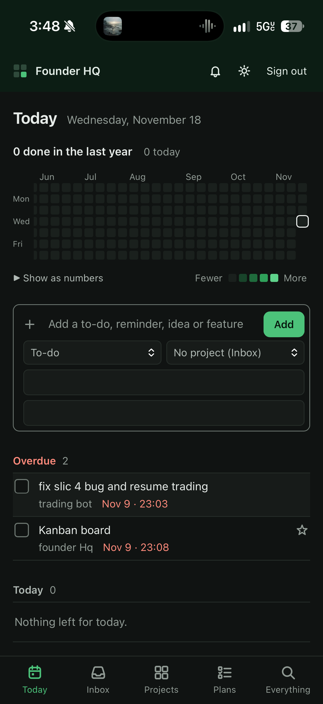
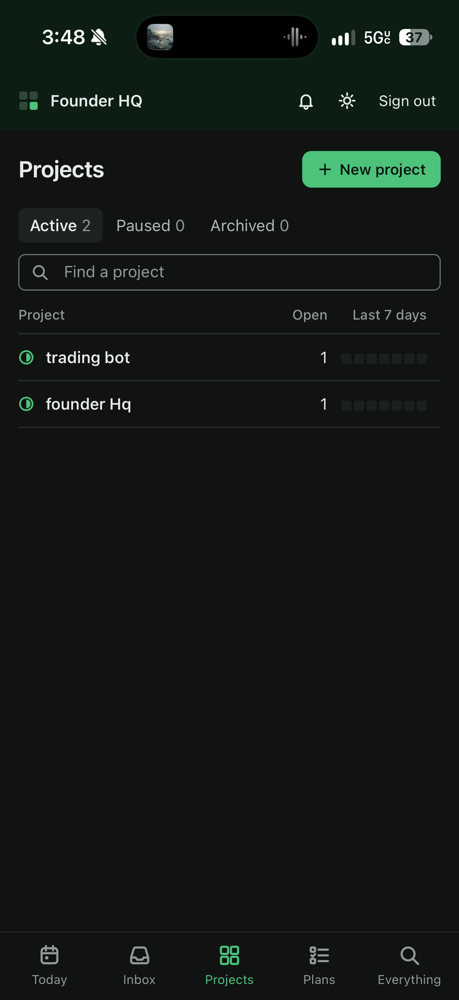
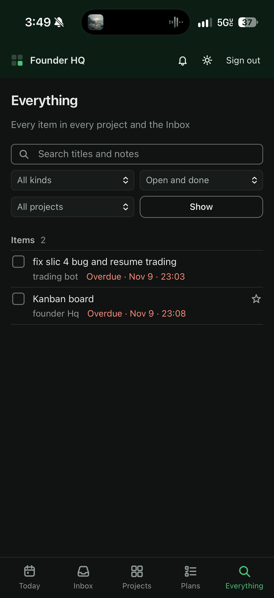
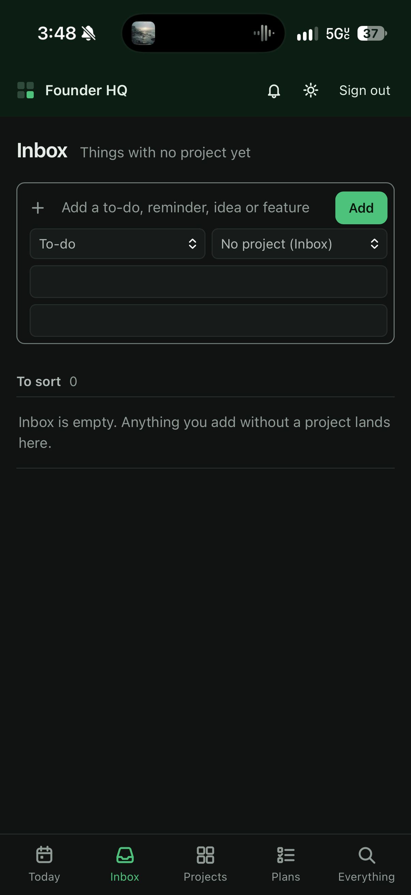

# Founder HQ

A free web app for people building several projects at once, often with AI tools: projects, to-dos, reminders, ideas and features in one place. Repo activity fills in from GitHub and from a small helper on your computer, and AI tools can read your list and add to it. Nothing assumes a project is software; those parts appear only on projects that connect them.

This repository is public to read. The code is not licensed for reuse: see [LICENSE](LICENSE).

- What it does: [docs/SPEC.md](docs/SPEC.md)
- How it is built, slice by slice: [docs/PLAN.md](docs/PLAN.md)
- Rules for coding agents: [AGENTS.md](AGENTS.md)

## Screens

The development copy on an iPhone, installed from the Home Screen, dark mode.

| Today | Projects | Everything | Inbox |
| --- | --- | --- | --- |
|  |  |  |  |

Today shows what is overdue, due today and coming up, above a year grid shaded by how much was ticked done each day. Projects is one row per project with its open count and the last seven days. Everything is every item with search and filters. Anything added without a project lands in the Inbox.

## Status (Nov 18, 2026)

Early build. The plan has 19 slices. A development copy runs on Vercel and Supabase with test data only.

Built and independently checked (records in [docs/agents/](docs/agents/)):

- Foundation and security baseline: forged requests refused, a per-request content policy, a secret scan on every commit, the master database key kept server-side.
- Sign-in by emailed link, by a 6-digit emailed code, and with GitHub, with per-address limits and a first-run screen.
- Projects: create, edit, pause, archive and delete, with row-level security and two-account isolation tests.
- Items: to-dos, reminders, ideas and features, the one-line add box, and "waiting on" between items.
- The views: Today, Inbox, Projects, Everything with search, the done-work year grid, light and dark mode, phone width, keyboard-only and VoiceOver runs.

Built, not yet independently checked:

- Installable on iPhone and Mac, the every-minute notification job, the hosted development setup, and the speed work for the phone.

Not built yet: live updates across devices, reminders in full, the GitHub connection, the helper program, the AI tool connection (MCP), export and account deletion, sessions, offline mode, and launch.

## How it is built

| Part | Choice |
| --- | --- |
| Website and server code | Next.js with TypeScript, hosted on Vercel |
| Database, sign-in, live updates | Supabase: Postgres with row-level security, Supabase Auth, Supabase Realtime |
| Phone notifications | Standard web push (`web-push`), sent by a route that a database scheduler calls every minute |
| Tests | Vitest unit tests, Playwright browser tests against a production build, and two-account isolation tests |

The security rules every change follows are in [AGENTS.md](AGENTS.md): no raw HTML, the master database key read in one file only, no secrets behind `NEXT_PUBLIC_` names, forged requests refused, plain logs, secrets in environment variables only.

The build runs in slices from the plan. Coding agents follow AGENTS.md. Each slice is recorded in `docs/agents/build.md` and checked by a separate, independent session, which writes `docs/agents/checks.md`.

## Folders

| Folder | What is in it |
| --- | --- |
| `src/` | The app: pages, components and the server-side library |
| `supabase/migrations/` | Every database change, as a new file each time |
| `tests/` | `unit/`, `integration/` (two-account isolation) and `e2e/` (browser) |
| `scripts/` | The build-secrets check and the local Supabase GitHub-mode switch |
| `docs/` | Spec, plan, research and the agent records |
| `public/` | Icons and the service worker for the installable app |

## Run it

Needs Node 20.9 or newer.

```
npm ci
npm run dev
```

Then open http://localhost:3000. `npm run check` runs every test and check.

Sign-in and the tests need local Supabase: start OrbStack (or Docker), then `npm run supabase:github-fake`, and write `.env.local` as [AGENTS.md](AGENTS.md) describes. Sign-in emails land in the local mail catcher at http://127.0.0.1:54324.

### GitHub sign-in on your computer

Register your own GitHub OAuth app for local use at https://github.com/settings/applications/new:

- Homepage URL: `http://localhost:3000`
- Authorization callback URL: `http://127.0.0.1:54321/auth/v1/callback`

Generate a client secret, then put both values in `supabase/.env` (git ignores it) and restart Supabase:

```
GITHUB_OAUTH_CLIENT_ID=
GITHUB_OAUTH_CLIENT_SECRET=
```

The live site uses a separate GitHub app, because each app has one callback address.

GitHub sign-in has two local modes. The browser tests need **fake** mode, where a small fake GitHub (started by the tests) stands in for github.com, so a whole sign-in can be tested, including how a matching email joins an account. To try "Continue with GitHub" with your own account, switch to **real** mode, and switch back before running the tests. Both keep your local data.

```
npm run supabase:github-real
```

```
npm run supabase:github-fake
```

## License

Copyright (c) 2026 Ayman Abdalla. All rights reserved. You can read the code here; you may not copy, change or reuse it without written permission. See [LICENSE](LICENSE). The app itself is free to use when it launches.
