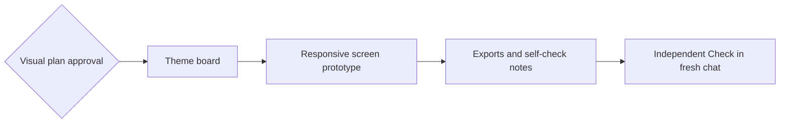
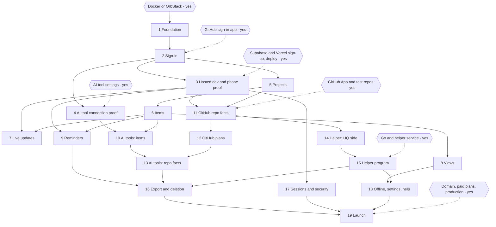

# Founder HQ: build plan

Status: **approved by Aym in chat on Nov 1, 2026** (the product plan: technology, cost stages and slices 1 to 19, within the limits under Approval; the Visual direction section keeps its own approval). Written Nov 1, 2026. Revised the same day after a two-angle helper review (feasibility and security).

- **Source of agreement:** [SPEC.md](SPEC.md), approved Nov 1 with all proposals P1 to P50. "Check N" below means the spec's section 5 check N.
- **Earlier plan:** the private page's plan is archived at [archive/personal-page-plan-2026-10.md](archive/personal-page-plan-2026-10.md).
- **Research:** product direction in [research-2026-11-01-product-direction.md](research-2026-11-01-product-direction.md). For the technology, three setups were each researched against the spec on Nov 1 and compared by a skeptical judge.

## Goal

Build Founder HQ as a free public web product for people building several projects with AI coding tools. They keep projects, to-dos, reminders, ideas and features in one place. Repo activity and plan progress fill in from GitHub and from a helper on their computer, and their AI coding tools can read and add to the same list. HQ installs on phone and Mac, sends phone reminders, and holds nothing specific to Aym.

## Visual direction and prototype plan — Nov 1, 2026

**Decision agreed; prototype plan proposed, awaiting approval.** Aym selected the new calm builder's studio direction, with the correction: "1, but no teal, change teal to royal blue". This settles spec open item 9 at the direction level. The details below are proposed implementation defaults. This section is a bounded visual task; its approval does not approve the public-product technology, spending, or slices 1 to 19 below.

### Feel and hierarchy

A quiet workspace for returning to several projects and seeing what needs attention. Warm ivory gives the page a little warmth; charcoal keeps it readable; royal blue marks the main action and current selection. Use generous spacing, fine borders, lightly rounded surfaces, and clear sans-serif type. Put today's work and the capture box first. Keep commit counts and charts secondary; activity does not establish completion.

### Proposed palette

| Role | Light | Dark | Use |
| --- | --- | --- | --- |
| Canvas | `#F6F4EF` | `#151619` | Warm paper in light mode; quiet charcoal in dark mode |
| Surface | `#FFFEFB` | `#1E2025` | Task lists, project cards and dialogs |
| Primary text | `#202927` | `#F4F2EC` | Headings, tasks and project names |
| Secondary text | `#626762` | `#B1B5BE` | Supporting details and timestamps |
| Royal blue | `#1845C7` | `#8BA9FF` | Primary action, links, selected navigation and focus |
| Blue tint | `#E9EEFC` | `#252F4D` | Selected surfaces; pair with the blue text above |
| Border | `#DEDCD5` | `#383B43` | Decorative separation; essential control boundaries get a stronger token |
| Warning text | `#914817` | `#F0B67D` | Overdue, stale and failed states, always with words or an icon |

Royal blue replaces teal throughout the accent system. Exact colours remain subject to measured contrast checks; pale borders cannot be the only way to identify a control. Define separate button foreground and background pairs in dark mode. Text targets: 4.5:1 for normal text and 3:1 for large text; essential controls and focus indicators target 3:1 against adjacent colours.

### Type, components and illustration

- System sans-serif stack, with no font download: 15–16px body text, 28–36px main headings, and 12–13px supporting labels. Use weight and spacing to create hierarchy. Reserve monospace for file paths, branch names and technical values.
- Start from a 4px spacing scale, 12px card corners, 8px control corners, and comfortable rows. Interactive targets are at least 44px where practical. A desktop sidebar becomes compact navigation on a phone; every agreed view stays reachable.
- Show Today, Inbox, Projects, Plans and Everything. The capture box supports title, kind, project, date and time, with optional fields tucked away until needed. Keep status labels visible: Active, Paused, Archived, Overdue, Updating late and Offline.
- Use simple geometric line illustrations: a central workspace with linked project tiles, a stacked plan with checkboxes, and a small inbox tray. Blue accents sit on ivory or charcoal. Build these as editable SVG/CSS shapes; they need no stock assets or generated raster images. Illustrations belong in the theme board, onboarding and empty states, with compact icons in working screens.
- Use "Founder HQ" as a working label only. A small provisional HQ tile can demonstrate the app icon without settling the product name or final logo.
- Motion is brief and purposeful: selection and completion transitions, with reduced-motion support. The screens stay still when idle.

### Visual slices and deliverables

Deliverables go in `/Users/aympulse/aym/agents/outputs/founder-hq/visual-direction/`. They are local previews with fictional sample data clearly labelled as a demo. The existing page and its hosted database are references for behaviour.

| Slice | Deliverable | Observable acceptance check | Blocked by |
| --- | --- | --- | --- |
| V1 | `theme-board.html`: palette, type, controls, status labels, provisional HQ tile and geometric illustrations, plus a light/dark switch | Open the board locally; every token and component is visible in both themes, with royal blue as the accent | Approval of this visual plan |
| V2 | `prototype.html`: responsive Today, Projects and individual-project screens, with sample tasks, capture fields, notes, and labelled GitHub/computer facts | Navigate between the three sample views; switch themes; inspect at 1440px desktop and 390px phone widths with no sideways scrolling | V1 |
| V3 | `design-notes.md` and exported PNGs of Today desktop light, Projects desktop dark and project detail on phone; screenshots and self-check results | Exported images match the preview; notes identify chosen tokens, demo-only controls, measured checks and unchecked limits | V2 |

The prototype demonstrates presentation and navigation. Demo actions change only temporary in-memory sample data and reset on reload. Sign-in, persistence, GitHub, notifications, helper connections and tool permissions are not simulated as working integrations. Inbox, Plans and Everything appear in navigation as labelled preview placeholders; their full layouts belong to the product build.

### Dependencies and verification

| Dependency | Exists now? | Provider | If missing |
| --- | --- | --- | --- |
| Behaviour and existing screen reference | Yes: `docs/SPEC.md`, `reference/page/founder-hq.html` (moved from `page/` in slice 1) | Project | Use only agreed behaviour; identify any visual-only simplification |
| Palette direction | Yes: Aym's Nov 1 choice above | Aym | No further direction decision required |
| Browser and screenshot route | Not yet verified for this task | Available browser tools or existing local browser tooling, checked at Build | Screenshot check is unavailable until a working route is established; report it plainly |
| Additional packages, accounts or external assets | None required by this prototype | — | Keep previews self-contained and use existing tools |

| Requirement | Planned check | State now |
| --- | --- | --- |
| Ivory, charcoal, royal blue; matching dark theme | Inspect computed colours and exported views against the palette | Planned; not run |
| Legible text, controls and status | Measure actual foreground/background pairs; inspect labels and focus indicators | Planned; not run |
| Phone and desktop layouts | Browser inspection at 390px and 1440px, plus a 320px overflow check and 200% zoom check | Planned; not run |
| Keyboard access and reduced motion | Tab through navigation, capture fields and theme control; inspect reduced-motion mode | Planned; not run |
| Honest repo facts and sample data | Check demo label, source labels and timestamps; check activity is not described as proof of completion | Planned; not run |
| Reusable assets | Read back self-contained HTML and editable illustrations; open PNG exports | Planned; not run |

Self-checks establish only the prototype's presentation and demo behaviour. After Build, a fresh chat performs the independent visual/accessibility/security Check. Existing hosted-database tests do not verify this prototype or the future public product.

### Security, risks and open decisions

**Security:** protect personal projects, private repo facts and credentials by using invented sample data only. The previews are local files reachable by whoever has the files. They load no external scripts, fonts or analytics, make no network requests, and take no credentials. Insert editable/demo text as plain text. Verify those properties in V3.

**Risks:** low-contrast decorative colours may be mistaken for control boundaries; measure essential controls separately. Illustrations and charts may compete with tasks; keep them small or outside the main work area. Static samples may suggest integrations work; retain explicit demo and source labels.

**Open decisions:** none blocks the visual prototype. Product naming, the wider app plan, hosting and integrations remain separate decisions. **Fog:** the final production components and full accessibility compliance require checks against the eventual running app.

### Visual flow and approval

Approving **this visual section only** authorizes creating V1 to V3 in the outputs folder, running local previews and capturing screenshots. It does not authorize building the public app, changing the existing hosted page, publishing, installing tools, spending, sending messages, or Git operations. Stop after Build and present the artifacts for independent Check.

## Technology (proposed, needs Aym's yes)

| Need | Choice | Why |
| --- | --- | --- |
| Website and server code | Next.js with TypeScript, hosted on Vercel | The setup AI coding tools know best. Plain Next.js can move to another host later. |
| Database, sign-in, live updates | Supabase: Postgres with row-level security, Supabase Auth, Supabase Realtime | Row-level security means the database itself refuses to show one account's rows to another. Sign-in by email and GitHub, and live updates, are built in. |
| Every-minute reminder job | A scheduler inside the database (pg_cron) calls a sending route on Vercel every minute | Vercel's free plan only allows daily jobs. |
| Phone notifications | Standard web push, using the open-source `web-push` library | Works for iPhone Home Screen apps, Android and Mac browsers. No Apple developer account needed. |
| GitHub connection | A GitHub App with read-only permissions, plus a webhook route GitHub calls on every push | The way GitHub recommends. Users pick the repos. |
| AI tool connection | An MCP server inside the Next.js app. Approval (OAuth) comes first from Supabase's sign-in service. If that fails slice 4, a hosted provider (WorkOS or Clerk) takes over, not hand-written code. HQ keeps its own records of each connection's permission level, last use and revocation. | **The riskiest part.** Supabase's approval service is in beta, so slice 4 proves it before anything depends on it. |
| Helper program | Go, shipped as one signed file per platform, with checksums, through GitHub Releases and a Homebrew tap. Runs in the background as a launchd service on macOS. | One file with nothing else to install. The key is kept in the macOS Keychain. |
| Sign-in emails | Resend, sending from HQ's own domain. In development, a local mail catcher that comes with local Supabase. | Supabase's built-in email only reaches the project's own team. |
| Tests | Vitest, Playwright, and scripted two-account isolation tests on every change | Agents can run all of them locally. |

**Runner-up:** Cloudflare, at about $5 a month from day one, with a mature MCP sign-in library. It lost because its database has no row-level security, so privacy would depend on every line of code getting it right.

**Two environments.** A development setup on free plans, used for building and testing. The production setup is created at launch (slice 19) in the chosen data region. Aym's real use starts there; anything entered in development is test data.

## Running cost (needs Aym's yes before any purchase)

| Stage | Monthly cost | What it buys |
| --- | --- | --- |
| Building and private testing (slices 1 to 18) | $0 | Vercel Hobby, Supabase Free, local mail catcher. Supabase Free pauses after a week without activity and keeps no backups. That is acceptable for test data. |
| Domain | about $10 to $15 a year (unconfirmed) | Sign-in emails to strangers and a stable address. Needed by slice 19. |
| Public launch (slice 19) | about $45 | Supabase Pro ($25: daily backups kept 7 days, no pausing) and Vercel Pro (about $20; Vercel's free plan is non-commercial only). Resend Free covers up to 100 emails a day. |
| About 1,000 users | about $45 to $65 | The same, plus Resend Pro ($20) if sign-in emails pass 100 a day. |

Spend alerts get set on Vercel and Supabase when paid plans start.

## Slices

Each slice ends with something you can see or checks that pass. The spec checks listed for a slice must pass before it counts as done. The two riskiest unknowns are tested early: the AI tool connection (slice 4) and iPhone notifications (slice 3).

| # | Slice | What you can see when it is done | Checks | Blocked by |
| --- | --- | --- | --- | --- |
| 1 | **Foundation.** Make this folder a git repo on branch `build-public-hq`, with AGENTS.md and CLAUDE.md. Move the current page into `reference/`. Set up the Next.js app, local Supabase, Vitest and Playwright. Add the security baseline (see Security) and the dependency rules. | The app runs locally. Tests, lint and the secret scan pass. A forged request from another website is refused. | Security tests S1 to S4 | Docker or OrbStack installed |
| 2 | **Sign-in.** Sign-in by emailed link, by a 6-digit emailed code (needed inside the installed iPhone app), and with GitHub. Same-email accounts never merge without confirmation. Sign-in rate limits, the empty first-run screen, and the isolation test against a placeholder table. | You sign up and in by all three methods locally, emails arrive in the mail catcher, and the first-run screen shows. | 2, 3, 12, S5 | 1; a GitHub sign-in app registered |
| 3 | **Hosted development setup and phone notification proof.** A free hosted Supabase and Vercel setup for development, with the database schema, secrets and sign-in addresses configured. The app becomes installable, and a test notification is sent from the every-minute job to your iPhone. | You sign in on your iPhone inside the installed HQ (Home Screen) and receive a test notification within a minute of its due time. The Mac Dock install also works. | 1, 29, 30, 32 (single test), S6 | 2; Supabase and Vercel sign-ups, first deploy |
| 4 | **AI tool connection proof.** A minimal MCP server with one action, "list projects", and the approval page (read only, read and add, or edit). HQ records connections, last use and revocation, with the security checklist (see Security). Tried with real Claude Code and real Codex. | Both tools connect after you approve, list your (empty) projects, and are refused after you disconnect them. Every negative test is refused. | 51 (empty account), 55, S7 | 2; adding HQ to Claude Code's and Codex's settings |
| 5 | **Projects.** Create, edit, pause, archive and delete (moving items to the Inbox or deleting them). Row-level security on the real tables, with the isolation tests moved onto them. A plain-words message when a save fails. | Spec section 3.2 works in the browser. Account B never sees account A's projects. | 4, 13, 14, 58 | 2 |
| 6 | **Items and the add box.** Add, tick, reopen, edit, move and delete items, including "New project…" and the input rules (no empty titles; reminders need a date). | Spec section 3.3 works in the browser. | 16 to 20 | 5 |
| 7 | **Live updates across devices.** Changes on one device appear on the others. | Tick an item on the laptop: the phone shows it within 5 seconds, measured. | 21 | 3, 6 |
| 8 | **The views.** Today, Inbox, Projects cards and Everything with search, plus empty states, phone width, light and dark mode, and the accessibility standard. | Spec section 3.4 behaves as written. Keyboard-only and VoiceOver runs of adding an item succeed. | 5, 22 to 25, 27, 28 | 6 |
| 9 | **Reminders, complete.** Account time zone, the 9:00 rule, every device notified, the "notification sent" mark, the messages for notifications that are off or impossible, the hide-titles setting, and protection of each device's notification sign-up. | Spec section 3.6 works on your iPhone and Mac. A test clock confirms the time-zone and 9:00 rules. | 7, 32 to 37, S8 | 3, 6 |
| 10 | **AI tool connection: items.** Read projects, items and notes. Add, tick and edit by permission level, no deleting, tool name on items, change history with undo, refusal for archived projects, a cap on changes per minute, and a list of connected tools. | Claude Code and Codex do what spec 3.9 allows for projects and items, and nothing it forbids. | 8, 51 to 56 | 4, 6 |
| 11 | **GitHub: repo facts.** Register the read-only GitHub App and create two test repos. Repo selection, the push webhook with its security checks, stored facts (not file contents), linking a repo or creating a project from one, and the last-checked time with a stale warning. | Push a commit to a test repo and the project shows it within 5 minutes, with no action in HQ. A replayed or forged webhook is refused. | 15, 38 to 40, 43, 44, 46, S9 | 3, 5; GitHub App and test repos |
| 12 | **GitHub: plans and edge cases.** Find plan documents and count checkboxes; the Plans view; the commit overview on Projects, with a text version of each chart; handling access ending from GitHub's side. | Plans shows the test file's counts, which change after a push. Revoking HQ on GitHub's own page is explained in HQ. | 26, 41, 42, 45 | 11 |
| 13 | **AI tool connection: repo facts and plans.** AI tools can read repo facts and plan documents. All text from repos reaches them labelled as repo data. | The poisoned commit message test passes: it shows as plain text, arrives labelled, and changes nothing. | 57 | 10, 12 |
| 14 | **Helper, HQ side.** Linking a computer with a one-time code you confirm in HQ. Per-computer keys stored only as a hash, write-only, rate-limited. The list of linked computers, the offline mark after 3 days, and helper facts shown next to GitHub facts. | Two test computers (two helper instances on your Mac) link and show separately. Unlinking one refuses it on its next send. | 49, 50, S10 | 11 |
| 15 | **Helper program for macOS.** The Go program with link, unlink, status, preview and send. Keychain storage, the background service, signed releases with checksums. | An uncommitted change on your Mac raises HQ's count. Preview shows only counts, names and dates. | 47, 48 | 14; Go installed; installing the service on your Mac |
| 16 | **Export and account deletion.** Download all data. Deletion with a typed confirmation that removes everything: rows, notification sign-ups, connections and keys. | Deleting test account A leaves zero of its rows anywhere, and its tools and helper are refused. | 6, 9, 10, S11 | 9, 10, 13, 15 |
| 17 | **Sessions and account security.** Signed-in device list, "sign out everywhere" that ends sessions on the server, security emails, and per-account limits. | Signing out everywhere on the laptop signs out the phone. Security emails arrive in the mail catcher. Reaching a limit shows a message and loses nothing. | 11, S12 | 2, 3; open item 12 numbers decided |
| 18 | **Offline mode, settings and help.** The installed app opens offline, read-only. A settings page shows each connection's state with setup steps, plus a help and abuse contact. | In airplane mode HQ opens, shows the last data and says saving is off. The settings page shows connected, not connected or problem for each connection. | 31 | 8, 11, 15 |
| 19 | **Launch.** Buy the domain and connect Resend. Create the production setup on paid plans in the chosen region. Publish the privacy policy and terms. Write the backup-restore runbook and rerun every check on the live site. Each step needs its own yes. | A stranger signs up at the public address and gets the sign-in email. All 58 checks pass on the live site. | All | 16, 17, 18; open items decided |

Helper on Linux moved out of these slices: it needs a Linux test machine. See Fog.

## Dependencies

| Dependency | Needed by | Exists now? | Provided by | If missing |
| --- | --- | --- | --- | --- |
| Node and npm | 1 | Yes (Node 26.7) | — | — |
| Git and GitHub CLI, signed in as AymAbdalla | 1, 11 | Yes | — | — |
| Docker Desktop or OrbStack, to run Supabase and its mail catcher locally | 1 | **No** | Aym installs after a yes (free for personal use) | Development uses the hosted free Supabase project instead, from slice 1 |
| Supabase CLI, Vercel CLI, Playwright browsers | 1, 3 | No | Fetched inside the project (`npx`, Playwright's installer) under the approved package rule | — |
| A GitHub sign-in app, separate from the GitHub App, with an ID and secret | 2 | No | Registered under Aym's GitHub account after a yes. Secret in `GITHUB_OAUTH_CLIENT_SECRET`. | Sign-in by email only until then |
| Supabase and Vercel accounts (free) | 3 | Unknown | Aym signs up after a yes | Phone notification checks cannot run: iPhone push needs a public HTTPS address |
| Notification keys (VAPID) | 3 | No | Generated in slice 3, stored in `VAPID_PRIVATE_KEY`, with a rotation note in the runbook | — |
| An iPhone with iOS 16.4 or newer, and the Mac | 3, 7, 9 | Assumed yes | Aym | Those checks show as unavailable |
| Claude Code and Codex, with HQ added to their settings | 4, 10, 13 | Tools yes (Claude Code 2.1.309, Codex CLI 0.160.0); settings change no | Each settings change after a yes | — |
| GitHub App registration and two test repos (one with a plan file of 3 ticked and 5 unticked boxes, one with none) | 11, 12, 13 | No | Created under Aym's GitHub account after a yes. App key in `GITHUB_APP_PRIVATE_KEY`, webhook secret in `GITHUB_WEBHOOK_SECRET`. | GitHub's recorded sample deliveries allow partial tests |
| Go toolchain | 15 | **No** | Homebrew install after a yes | Slice 15 waits |
| Domain, Resend, paid plans, production setup | 19 | No | Each after a yes | No public launch |

Secrets live only in environment variables and in Vercel's and Supabase's secret stores: `SUPABASE_SERVICE_ROLE_KEY`, `GITHUB_OAUTH_CLIENT_SECRET`, `GITHUB_APP_PRIVATE_KEY`, `GITHUB_WEBHOOK_SECRET`, `VAPID_PRIVATE_KEY`, `RESEND_API_KEY` and `CRON_SECRET`. They never go in the repo, in logs, in saved evidence, or in this plan.

## Verification

| Spec section | Checks | How they run |
| --- | --- | --- |
| 2 and 3.1 Accounts and privacy | 1 to 12 | Playwright with two test accounts. The isolation tests also run automatically on every change and must pass before anything merges. Emails are read from the mail catcher. |
| 3.2 to 3.4 Projects, items, views | 13 to 28 | Playwright. Check 21 uses two signed-in sessions and times the update. Check 28 also needs a manual VoiceOver run by Aym. |
| 3.5 Installable and offline | 29 to 31 | 29 and 30 by hand on the iPhone and Mac. 31 with Playwright's offline mode plus one manual airplane-mode run. |
| 3.6 Reminders | 32 to 37 | By hand on a real iPhone and Mac, with times written down. The time-zone and 9:00 logic is also tested automatically with a controllable test clock. |
| 3.7 GitHub | 38 to 46 | Against the test repos with real pushes. Webhook handling is also tested with GitHub's recorded samples. Check 44 uses a test-only way to age the last-checked time instead of waiting 36 hours. |
| 3.8 Helper | 47 to 50 | The helper's own tests, plus runs on the Mac against a test repo. Preview output is scanned for file contents and full paths. |
| 3.9 AI tools | 51 to 56 | Real Claude Code and Codex sessions, with prompts and replies saved as evidence, scrubbed of keys and private text. The permission rules are also tested automatically. |
| 3.10 Safety | 57, 58 | A crafted commit in a test repo for 57. Playwright offline mode for 58. |
| Security | S1 to S12 | Automated, listed under Security. |

Every slice ends with its checks run and recorded in `docs/agents/build.md`. A fresh chat, or Codex, checks every two to three slices independently, as the house rules require.

## Security

**What is worth protecting:**
- each user's projects, items and notes
- facts about their private repos (commit messages can contain sensitive wording)
- sign-in sessions
- the GitHub App's private key, which can read every repo any user granted
- helper keys and AI tool access
- the server's master database key, which bypasses row-level security

**Who can reach it:**
- anyone on the internet, through sign-up, sign-in and every public route
- other websites, through the user's browser (forged requests)
- GitHub, through the webhook
- any AI tool a user connects, plus fake tools trying to trick a user into approving them
- any computer holding a helper key
- text other people write into a user's repo, which reaches HQ and AI tools

**What stops misuse, and the test that proves each:**

| # | Protection | Slice |
| --- | --- | --- |
| S1 | Security headers: a strict content policy without inline scripts, no framing by other sites, HTTPS only. Cookies set so other sites cannot use them. Every data-changing request checks it came from HQ itself. **Test:** a cross-site request to delete an item is refused, and the consent page cannot be shown inside another site. | 1 |
| S2 | The master database key lives in one server-only module that requires an account ID. Routes for AI tools and the helper run as that account, so row-level security still applies. **Test:** a build check fails if the key appears in browser code or in any public setting, and a lint rule bans using the master client outside that module. | 1 |
| S3 | No raw HTML anywhere: a lint rule bans it, so text from repos and AI tools can never run as code. | 1 |
| S4 | Supply chain and logs. Lockfiles committed, clean installs, automatic dependency alerts, an audit in every check run. Agents add a package only with a stated reason, after confirming it is an established package. A secret scanner runs before every commit. Logs never contain keys, request bodies from the webhook, AI tool or helper routes, or private repo text. **Test:** a test request containing a fake key leaves no trace of it in the logs. | 1 |
| S5 | Sign-in. Same-email accounts never merge without confirmation, including GitHub sign-in with an unconfirmed email. Rate limits on sign-in attempts and on emails per address. **Tests** for each. | 2 |
| S6 | Notification sign-ups are bound to the signed-in account, re-bound when another account signs in on the same browser, and removed on sign-out everywhere and on account deletion. | 3, 9 |
| S7 | AI tool approval. Required: PKCE, exact redirect-address matching, a checked state value, a consent page that names the tool and shows where it sends you, short-lived access, and tokens valid only for HQ. Permission level is read from HQ's own records, never from the token. **Negative tests:** a changed redirect address, a reused approval code, a forged permission level, and a token made for another service are all refused. | 4 |
| S8 | **Two-account test on the reminder sender:** A's reminders only ever reach A's devices, including after A and B used the same browser. | 9 |
| S9 | GitHub webhook. Signature checked over the raw message with a constant-time comparison. Each delivery ID stored once, so replays are refused. Installations map to accounts only through HQ's own records. Deliveries for unselected repos are ignored. **Tests:** bad signature, missing signature, altered body, replayed delivery, and an installation belonging to another account. | 11 |
| S10 | Helper keys. Linking needs a one-time code confirmed inside HQ, so a tricked user cannot silently link someone else's computer. Keys are stored only as a hash, can only write facts for their own account, cannot read anything, and are rate-limited. The helper never logs its key. **Tests:** a key reading data is refused, a key writing to another account is refused, and a link code works once. | 14 |
| S11 | **Deletion completeness test:** counts every table and store for the deleted account and expects zero. | 16 |
| S12 | "Sign out everywhere" ends sessions on the server, not just by waiting for tokens to expire. Sensitive actions re-check the session. | 17 |

**Backups:** production keeps Supabase's daily backups for 7 days (open item 5, proposed). The privacy policy says deleted data leaves backups within 7 days. The restore runbook (slice 19) says: after restoring a backup, replay the deletion log so deleted accounts stay deleted.

## Scheduled and repeating jobs

| Job | Trigger | What it may change | Record of each run | Stop rules |
| --- | --- | --- | --- | --- |
| Reminder sender | Every minute (pg_cron calls a route that needs `CRON_SECRET`) | Only reminders due and not yet sent: marks them sent or failed | Each reminder's sent or failed time and its attempt count | At most 3 attempts per notification, then marked "not delivered" and shown in Today. A capped number of sends per run; the rest wait a minute. Expired device sign-ups are removed. |
| GitHub refresh | Each push webhook, plus one safety-net check a day per repo | Only that repo's stored facts | Each repo's last-checked time and last error | On a rate-limit reply, wait as GitHub says and show "updating late". After 5 repeated errors, mark the repo as having a problem, shown to the user. |
| Helper | A timer on the user's computer every few minutes, plus file changes | Nothing on the computer; only that computer's facts in HQ | Last send time per computer | A refused key stops the helper and tells the user. Gentle back-off, no retry storms. |

Each job runs often and checks its own results. Each one is run once by hand during its slice before it is put on a schedule.

## Risks, open decisions and fog

**Open decisions, in the order they are needed:**
- **Technology and cost stages above:** with this plan's approval.
- **Look and feel:** direction settled Nov 1: new calm builder's studio, warm ivory and charcoal with royal blue. The bounded visual prototype plan above awaits approval; final production components remain part of the product build.
- **Timing targets** (spec open item 3). This plan uses the proposed values (5 seconds, 1 minute, 5 minutes, 36 hours, 3 days) unless you change them.
- **Account limit numbers** (open item 12), by slice 17.
- **Backup period** (open item 5, proposed 7 days), by slice 19.
- **Data region** (open item 10), by slice 19, before the production setup is created.
- **Name and domain** (open item 4), by slice 19.

**Risks:**
- **Supabase's approval service fails slice 4.** It is in beta, and binding tokens to HQ, revocation and newer client registration are undocumented. The fallback is a hosted provider (WorkOS or Clerk), decided before slice 10. Hand-written OAuth is avoided because it is security code that's easy to get wrong.
- **iPhone notifications prove unreliable in slice 3.** The approach would then need rethinking, possibly with an App Store app later, which version 1 excludes. Decided with you if it happens.
- **A privacy leak through server code.** Limited by S2, which keeps row-level security in force even for server routes, and by the isolation tests that must pass before anything merges.
- **Supabase Free pauses the development project** after a week without use. It is restored with a click, and it only holds test data.
- **Sign-in emails eaten by email scanners** that open links early. The 6-digit code from slice 2 covers it.
- **Size.** This is a large build. Slices 1 to 10 give a usable HQ without GitHub and the helper, so you can use the development version well before launch.

**Open items found while building:**
- **Slice 2, GitHub sign-in:** built Nov 2 ("Continue with GitHub", `/auth/github` and `/auth/callback`). Aym decided Nov 2 to use Supabase's standard behavior: a GitHub sign-in whose verified email matches an existing account joins that account without an extra confirmation step. A GitHub email that is not verified does not join; Supabase makes a separate account. This differs from spec P2 and S5 ("never merged without the user confirming"); the spec wording is Aym's to change. Not covered by automated tests: the same-email joining and the unverified-email case, which need a stand-in GitHub that local Supabase can reach. Checked by hand only, by signing in with a real GitHub account.
- **Slice 2, sign-in limits:** HQ keeps its own per-address limits (`private.sign_in_events`). Supabase's per-IP limits count HQ's server, not each visitor, so they are only a backstop. Fixed Nov 2: only HQ's server can call the limit function (through `src/lib/supabase/admin.ts`). What remains is built into any per-address limit: someone can still ask HQ's sign-in form for codes to another person's address, five times an hour. That person can still sign in with the newest code in their inbox.
- **Slice 3, hosted settings:** copy the local auth settings to the hosted project: the sign-in email template, allowed sign-in link addresses (`/auth/confirm` and `/auth/callback`), and the 60-second email frequency. GitHub sign-in on the hosted project needs its own GitHub sign-in app, with the hosted Supabase callback address (a yes).

**Fog:**
- Helper on Linux (and Windows, open item 7): revisit after slice 15, when a Linux test machine is available.
- Email reminders (open item 6): revisit after slice 9.
- Real running costs: revisit at 50 or more users.

## Flow

## Approval

**Approving this plan authorizes:**
- building slices 1 to 18 in this folder
- making it a local git repo, and moving the current page into `reference/`
- committing finished slices with their agent records on the local branch `build-public-hq`
- adding packages inside this project, under the rule in S4: a stated reason, an established package, and a lockfile

**It does not authorize.** Each of these needs its own yes when its slice arrives, as listed in Dependencies:
- installing Docker, OrbStack or Go
- installing the helper service on your Mac
- signing up for Supabase, Vercel or Resend
- registering the GitHub sign-in app or the GitHub App
- creating repos or pushing to them
- changing Claude Code's or Codex's settings
- deploying
- sending test notifications or emails to real devices or addresses outside the mail catcher
- buying the domain or any paid plan
- pushing or merging the code
- publishing the privacy policy or the site
