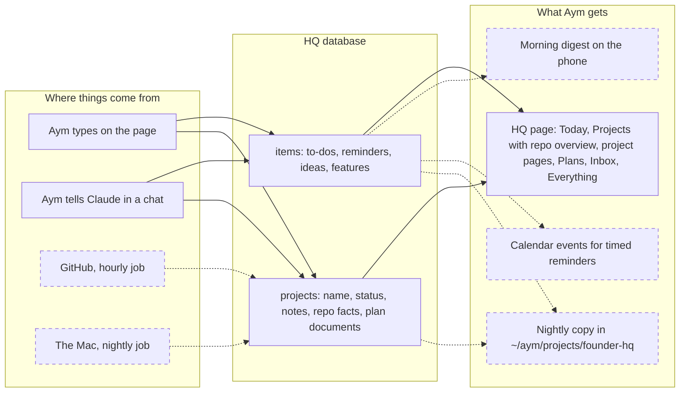

# Archived: personal page plan (Oct 11 to Nov 1, 2026)

This was the plan for the private claude.ai page. On Nov 1, 2026 HQ became a public product, and the build plan in [../PLAN.md](../PLAN.md) replaced this one. Choice 3 (how fresh repo data is) was superseded by the spec: repo facts update on every push. Choice 4 (morning digest and calendar events) became open item 6 in [../SPEC.md](../SPEC.md). Kept unchanged below for the record.

---

# Founder HQ: plan and status

Last updated Nov 1, 2026. On Nov 1 HQ became a public product; see choice 5. The steps below describe the original personal page.

## Goal

One place that holds every project, repo, idea, feature, to-do, reminder and plan. It shows them live, and Aym can add things and assign them to a repo or project on the page. Every project can be clicked into.

## How it fits together

Solid boxes are built. Dashed boxes are planned.

## What was found on Oct 11

- Ten repos on GitHub. Eight are checked out under `~/aym`. `influincer` and `AymAbdalla` were not found there and were not read.
- Plans and to-dos already live inside the repos: 64 plan, to-do and idea documents with 368 unticked checkboxes. Some plans have every box unticked, so the boxes alone do not show what is left.
- Morrow already models projects, open loops, tasks and deadlines.
- Notion was removed on Oct 4 and records stay in Aym's own folders, so this plan does not use Notion.
- No GitHub connection exists that a page can query by itself. Repo data has to be brought in by a scheduled job.
- The Dashboard template can show data but cannot save typed input.

## Choices

| # | Choice | Status |
| --- | --- | --- |
| 1 | Where things are added | **Decided by Aym, Oct 11:** on the HQ page itself. Built as an interactive page with its own database, because the Dashboard template cannot save input. **Oct 12:** Aym asked for one page, so the dashboard's repo overview, plans table and build plan were moved into HQ and the dashboard was retired. |
| 2 | Tasks here or in Morrow | **Settled by Aym, Nov 1:** Morrow is dropped. HQ keeps its own list and replaces Morrow as the focus. |
| 5 | Personal tool or product | **Decided by Aym, Nov 1:** HQ becomes a product other people can use. **Audience, decided Nov 1:** people building several projects with AI coding tools, so repo status (GitHub and a local helper) matters early. **Approach, decided Nov 1:** build a real public product now, without a test-first round. Aym is the first user, and nothing in the build is specific to Aym: no hardcoded projects, paths or personal data. Aym's own projects get in through the product like anyone's. **Pricing, decided Nov 1:** free at launch, with no payment code. Accounts and data are set up so a paid plan can be added later without a rebuild. **First-version scope, decided Nov 1:** everything. The core (sign-up and login; projects with to-dos, reminders, ideas and features; Today, Inbox, Projects and Everything views; installable on phone and Mac), plus phone reminders, a read-only GitHub connection, a connection for AI coding tools, and a helper program for the user's computer. Clarify finished Nov 1; the spec is next. Research: [research-2026-11-01-product-direction.md](../research-2026-11-01-product-direction.md). |
| 3 | How fresh repo data is | **Open.** Recommended: GitHub hourly from the cloud, plus the Mac nightly for unpushed work. |
| 4 | How reminders reach Aym | **Open.** Recommended: a morning digest on the phone, plus a calendar event for reminders with a set time. |

## What HQ holds

| Thing | Plain meaning | Belongs to |
| --- | --- | --- |
| Project | Something being built. Usually one repo, sometimes none yet. | Nothing |
| Idea | A thought that is not a project yet. | A project, or the Inbox |
| Feature | Something a project should be able to do. | A project |
| To-do | One action that can be finished. Can have a finish-by date and time. | A project, or the Inbox |
| Reminder | A nudge on a date, with an optional time. | A project, or the Inbox |
| Plan document | A pointer to a plan file inside a repo, with its checkbox counts. The file stays the source of truth. | A project |

## Steps

### Step 0: inventory and plan. Done Oct 11.

First delivered as a separate repo snapshot dashboard. Data totals were cross-checked against the totals computed on the Mac. On Oct 12 the inventory moved into HQ (the repo overview on Projects, and the Plans view) and this plan's open steps became features and to-dos in HQ's own Founder HQ project.

### Step 1: the HQ page with its database. Built Oct 11.

What exists:

- A box at the top to add a to-do, reminder, idea or feature, with a project picker (including "New project…"), a date and a time.
- Views: Today (overdue, today, next 7 days, later, no date), Projects with a repo overview on top, one page per project, Plans (every plan document, searchable and sortable), Inbox with quick assign, Everything with search and filters.
- Items can be ticked done, reopened, edited and deleted with a two-press confirm.
- A project page shows its items, repo facts, a 30-day commit chart, its plan documents and editable notes.
- Twelve projects seeded: the ten repos, the retained-ideas notes folder, and Founder HQ itself.

Acceptance check: add an item on the phone and see it on the laptop, assign it to a repo, tick it, reload, and it is still there.

Evidence so far:

- A browser test drives the page through 56 checks against a stand-in database. All pass as of Oct 12. See `tests/`. On Oct 12 it caught a real bug in the new chart tooltip before publishing.
- An independent reviewer read the code against the requirements and the database contract. It found 13 issues, none high severity. Twelve were fixed and the test rerun. One was kept on purpose: opening a project page switches the project picker to that project, even if another project was picked before. A second review on Oct 12 covered the merged-in overview and Plans view: 9 issues, none high severity, all fixed.
- The 12 project records and the 9 plan items were written to the real database and read back.
- A test item was written to the real database, found by the same two queries the page uses, and deleted.

Not verified: the published page saving to the real database from a signed-in browser. Claude's browser was not signed in to claude.ai. As of Oct 12 the database holds no item or note written from the page, so there is still no evidence either way. The acceptance check above is still Aym's to run.

### Step 2: repo sync. Not built.

A scheduled job reads GitHub (and optionally the Mac) and updates each project's `git` and `docs` blocks. The page shows when it last synced and flags itself when that is too old.

Starts by proving what a cloud job can read: on Oct 11 a cloud session could list repos and their last push, but GitHub refused per-repo detail until each repo was attached to the session.

Done when: a pushed commit shows after the next run, and with the job off the page says it is stale.

### Step 3: plans and existing to-dos. Partly built.

Plan documents are listed per project with their checkbox counts from the Oct 11 snapshot. Not built: refreshing those counts, and picking open items from a plan to turn into HQ to-dos. No bulk import.

Done when: counts on the page match a fresh search of the repo files, shown side by side.

### Step 4: reminders reach the phone. Not built.

Done when: a reminder set for the next morning arrives, and the page marks it as sent.

### Step 5, optional: capture from any chat, and a weekly review. Not built.

Done when: an item added from a different chat appears on the page.

### Later

Hand a feature off to its repo as a plan document. A link to Morrow. GitHub issues. Each is its own decision.

## Limits

- The database is hosted with the page, not on the Mac. The nightly copy is planned so the records also exist on disk.
- The page is private. If it is shared, everyone it is shared with can read everything in it.
- The day-job repo shows git activity only. No account or contact data goes into HQ.
- Commit counts measure activity, not progress.
- The page loads up to 1,000 open items and the 200 most recently finished ones.
